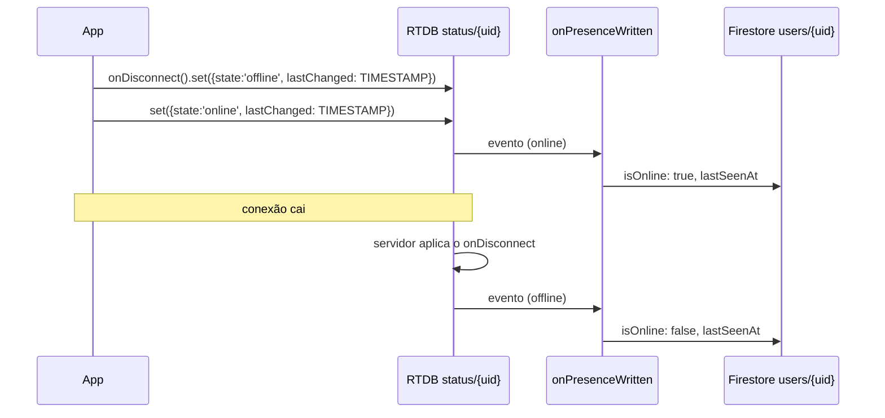

# 7. Function `onPresenceWritten`

[← Índice](DOCs.md)

| | |
|---|---|
| Tipo | trigger do Realtime Database (`onValueWritten`) |
| Região | **`us-central1`** (exceção) |
| Disparo | qualquer escrita em `/status/{uid}` no RTDB |
| Arquivos | `functions/src/presence/onPresenceWritten.ts` (adaptador), `functions/src/presence/mirror.ts` (lógica) |
| Testes | `test/mirrorPresence.test.ts` |
| Escreve | `users/{uid}.isOnline` e `users/{uid}.lastSeenAt` |

## 7.1 Por que o RTDB

O Firestore não sabe quando um cliente **cai**. O Realtime Database sabe,
pelo `onDisconnect()`: o servidor executa uma escrita combinada quando a
conexão some, mesmo que o app tenha sido morto ou o celular tenha perdido o
sinal.

O fluxo:



Os outros usuários **não leem o RTDB** (as regras só deixam cada pessoa ler o
próprio nó). Eles veem a presença pelo Firestore, em `users.isOnline` e nos
cartões de busca.

## 7.2 Por que `us-central1`

Um trigger de RTDB precisa estar na região da instância do banco, e não
existe Realtime Database em São Paulo. Por isso a Function sobrescreve a
região padrão:

```ts
onValueWritten({ ref: '/status/{uid}', region: 'us-central1' }, ...)
```

Sem `instance`, o trigger vale para todas as instâncias do projeto. Só existe
a padrão, e assim o mesmo código roda no emulador.

A escrita no Firestore (São Paulo) sai de `us-central1`. Isso acrescenta
latência de rede, mas não muda o comportamento.

## 7.3 Passo a passo (`mirrorPresence`)

1. O adaptador lê `event.data.after`. Se o nó foi apagado, `presence = null`,
   que é tratado como offline.
2. `isOnline = presence?.state === 'online'`.
3. `changedAtMs = presence.lastChanged` (ou `now` se o nó foi apagado).
4. Numa transação, lê `users/{uid}`:
   - **Não existe** → retorna `'no_profile'` sem escrever. Quem ainda está no
     onboarding não tem perfil, e criar um documento só com presença
     quebraria as regras e a busca.
   - **`lastSeenAt` mais novo que `changedAtMs`** → retorna `'stale'`. O
     evento chegou fora de ordem e é descartado.
   - Senão, grava `{ isOnline, lastSeenAt: new Date(changedAtMs) }` e retorna
     `'updated'`.

### Por que descartar eventos antigos

Os triggers do RTDB **não chegam garantidamente em ordem**. Sem essa
checagem, um "online" atrasado poderia chegar depois do "offline" seguinte e
deixar a pessoa online para sempre. `lastSeenAt` guarda o `lastChanged` do
último evento aplicado e funciona como um relógio.

A regra do RTDB exige `lastChanged <= now`. Uma data no futuro faria todos
os eventos seguintes serem descartados como "antigos".

### Por que não mexe em `updatedAt`

`updatedAt` marca edição de perfil. A presença muda toda vez que o app vai
para segundo plano, e atualizar `updatedAt` aí perderia o sentido do campo.

## 7.4 Efeitos em cadeia

A escrita em `users/{uid}` dispara `onUserWrittenSyncCards`, que atualiza
`isOnline` em todos os cartões da pessoa (ver
[doc 8](08-functions-searchCards.md)).

## 7.5 Testes

`test/mirrorPresence.test.ts`:

- espelha online e offline com o horário do RTDB;
- descarta evento mais antigo que o último aplicado;
- nó apagado vira offline;
- não cria perfil para quem ainda está no onboarding.
