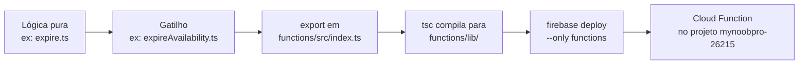

# 13. Do código ao Firebase: como uma função passa a rodar lá

[← Índice](DOCs.md)

Escrever uma função TypeScript em `functions/src/` **não basta** para ela
rodar no Firebase. Uma função comum (`async function fazAlgo() {}`) é só
código. O Firebase só executa o que cumprir três condições:

1. a função está **envolvida num gatilho** do `firebase-functions`;
2. o gatilho está **exportado** em `functions/src/index.ts`;
3. o código foi **compilado e publicado** com `firebase deploy`.

Este documento mostra cada passo usando as Functions que já existem no
repositório.

---

## 13.1 O caminho completo



O que o Firebase executa de fato é `functions/lib/index.js`. Esse é o `main`
do `functions/package.json`, e é para lá que o `tsc` compila o
`functions/src/`. Toda constante **exportada** desse arquivo que tenha sido
criada por um gatilho (`onCall`, `onSchedule`…) vira uma Cloud Function com o
mesmo nome do export.

---

## 13.2 Passo 1: separar a lógica do gatilho

O projeto adota um padrão em todas as Functions. **A lógica fica num arquivo
e o gatilho em outro.**

| Function (gatilho) | Lógica pura que ela chama |
|---|---|
| `users/completeOnboarding.ts` | `users/onboarding.ts` → `parseOnboardingInput`, `createProfile` |
| `availability/expireAvailability.ts` | `availability/expire.ts` → `expireAvailabilities` |
| `presence/onPresenceWritten.ts` | `presence/mirror.ts` → `mirrorPresence` |
| `search/syncSearchCards.ts` | `search/cards.ts` → `syncUserCards` |

A lógica pura recebe `db` e o "agora" (`Timestamp`) **como parâmetros**:

```ts
// functions/src/availability/expire.ts
export async function expireAvailabilities(db: Firestore, now: Timestamp) { ... }
```

Esse padrão tem três vantagens:

- **Os testes** (`test/*.test.ts`) importam a lógica direto e a rodam contra
  o emulador, com um `now` fixo. Não precisam disparar a Function.
- **Os scripts** reaproveitam a mesma lógica. O
  `scripts/rebuild-search-cards.ts` importa `syncUserCards`, a mesma função
  que os triggers usam.
- **O arquivo do gatilho fica curto**: só valida a entrada, lê o evento e
  chama a lógica.

---

## 13.3 Passo 2: escolher o gatilho

O gatilho decide **quando** a função roda. O repositório já usa quatro tipos.

### a) `onCall`: o app chama a função

Exemplo: **`completeOnboarding`**.

```ts
// functions/src/users/completeOnboarding.ts
import { HttpsError, onCall } from 'firebase-functions/v2/https';

export const completeOnboarding = onCall(async request => {
  if (!request.auth) {
    throw new HttpsError('unauthenticated', 'Faça login para continuar.');
  }
  const { uid, token } = request.auth;
  // ...
  return createProfile(db, { uid, email: token.email, ... }, input, now);
});
```

- O app chama pelo SDK do cliente:
  `httpsCallable(functions, 'completeOnboarding')(dados)`.
- `request.auth` já vem preenchido com o usuário logado (o Firebase valida o
  token). Se vier vazio, a pessoa não está logada.
- `request.data` traz o que o app enviou. **Trate esse dado como não
  confiável e valide tudo**, como faz o `parseOnboardingInput`.
- Os erros saem com `HttpsError`, e o app recebe o `code` e a mensagem.
- O valor retornado chega ao app como resposta.

Use quando o app precisa pedir uma ação que ele não pode fazer sozinho por
causa das regras (ver "cliente lê, Function escreve" em
[Arquitetura](01-arquitetura.md)).

### b) `onSchedule`: roda de tempos em tempos

Exemplo: **`expireAvailability`**.

```ts
// functions/src/availability/expireAvailability.ts
import { onSchedule } from 'firebase-functions/v2/scheduler';

export const expireAvailability = onSchedule(
  { schedule: 'every 10 minutes', timeZone: 'America/Sao_Paulo' },
  async () => {
    const count = await expireAvailabilities(db, Timestamp.now());
    if (count > 0) logger.info(`expireAvailability: ${count} disponibilidade(s) vencida(s)`);
  },
);
```

- No deploy, o Firebase cria um job no **Cloud Scheduler** que chama a
  Function no intervalo definido.
- `schedule` aceita o formato `every N minutes` ou cron (`'0 3 * * *'` = todo
  dia às 3h).
- Ninguém chama essa função. Ela não recebe dados nem tem usuário.

Use para limpeza, expiração e recálculos periódicos.

### c) `onDocumentWritten`: reage a mudanças no Firestore

Exemplo: **os três triggers de `searchCards`**.

```ts
// functions/src/search/syncSearchCards.ts
import { onDocumentWritten } from 'firebase-functions/v2/firestore';

export const onUserWrittenSyncCards = onDocumentWritten('users/{uid}', event =>
  sync(event.params.uid, 'user'),
);

export const onListingWrittenSyncCards = onDocumentWritten('listings/{listingId}', async event => {
  const owners = new Set(
    [event.data?.before.get('ownerId'), event.data?.after.get('ownerId')].filter(...)
  );
  await Promise.all([...owners].map(uid => sync(uid, 'listing')));
});
```

- O caminho com `{uid}` é um curinga, e o valor chega em `event.params.uid`.
- `event.data.before` e `event.data.after` são o documento antes e depois da
  escrita. Na criação, `before` não existe. Na exclusão, `after` não existe.
- `onDocumentWritten` cobre criar, alterar e apagar. Também existem
  `onDocumentCreated`, `onDocumentUpdated` e `onDocumentDeleted` quando só um
  desses casos interessa.

> ⚠️ **Cuidado com loop.** Se o trigger escreve no mesmo documento que o
> dispara, ele roda de novo. O `onUserWrittenSyncCards` escreve `gameIds` em
> `users/{uid}`, o que dispara o próprio trigger outra vez. Ele só para porque
> a `syncUserCards` **não escreve nada quando não há mudança**. Todo trigger
> novo precisa dessa mesma garantia.

Use para manter dados desnormalizados (cópias, contadores, índices de busca).

### d) `onValueWritten`: reage a mudanças no Realtime Database

Exemplo: **`onPresenceWritten`**.

```ts
// functions/src/presence/onPresenceWritten.ts
import { onValueWritten } from 'firebase-functions/v2/database';

export const onPresenceWritten = onValueWritten(
  { ref: '/status/{uid}', region: 'us-central1' },
  async event => {
    const presence = event.data.after.exists() ? (event.data.after.val() as Presence) : null;
    await mirrorPresence(db, event.params.uid, presence, Timestamp.now());
  },
);
```

Funciona como o trigger do Firestore, mas lê o valor com `.val()` e testa a
existência com `.exists()`. Esta Function **sobrescreve a região** porque o
trigger do RTDB precisa ficar na região da instância (veja 13.4).

### e) `onRequest`: uma URL HTTP (ainda não usado aqui)

```ts
import { onRequest } from 'firebase-functions/v2/https';

export const webhookPagamento = onRequest(async (req, res) => {
  res.json({ ok: true });
});
```

Gera uma URL pública. Sirva-se dela para webhooks de serviços externos. Para o
próprio app, prefira `onCall`, que já valida o login.

---

## 13.4 Passo 3: região e opções globais

`functions/src/globalOptions.ts` define o padrão de todas as Functions:

```ts
setGlobalOptions({ region: 'southamerica-east1', maxInstances: 10 });
```

- **`region`**: é a mesma do Firestore, para evitar latência e tráfego entre
  regiões.
- **`maxInstances`**: é um teto de custo caso um bug (ex: um trigger em loop)
  dispare chamadas demais.

Uma Function pode sobrescrever o padrão nas próprias opções, como o
`onPresenceWritten` faz com `region: 'us-central1'`.

> ⚠️ O `import './globalOptions.js'` precisa ser a **primeira linha** do
> `index.ts`. Em ES modules, os `export ... from` são avaliados antes do corpo
> do arquivo. Se o `setGlobalOptions` estivesse depois, as Functions iriam
> para `us-central1`. Isso aconteceu no primeiro deploy, em 29/10/2026.

---

## 13.5 Passo 4: exportar em `index.ts`

**Só vira Cloud Function o que estiver exportado aqui:**

```ts
// functions/src/index.ts
import './globalOptions.js';

export { completeOnboarding } from './users/completeOnboarding.js';
export { expireAvailability } from './availability/expireAvailability.js';
export { onPresenceWritten } from './presence/onPresenceWritten.js';
export {
  onListingWrittenSyncCards,
  onPlayerGameWrittenSyncCards,
  onUserWrittenSyncCards,
} from './search/syncSearchCards.js';
```

- O **nome do export** é o nome da Function no Firebase. Se você renomear o
  export, o deploy cria uma Function nova e pergunta se deve apagar a antiga.
- Os imports usam a extensão **`.js`** mesmo em arquivos `.ts`, por causa do
  `"module": "nodenext"`. Sem ela, o `tsc` dá erro.
- As funções auxiliares (`expireAvailabilities`, `syncUserCards`…) **não**
  devem ser exportadas aqui, porque não são gatilhos.

---

## 13.6 Passo 5: acesso ao banco (`lib/admin.ts`)

Toda Function importa `db` (e `auth`) de `functions/src/lib/admin.ts`:

```ts
import { db } from '../lib/admin.js';
```

Esse módulo chama `initializeApp()` uma única vez por instância. Dentro do
Firebase, o Admin SDK pega as credenciais automaticamente, sem chave nem
`projectId`. **Não chame `initializeApp()` em outro arquivo.**

O Admin SDK **ignora as regras de segurança**. Então a validação que as regras
fariam passa a ser responsabilidade da Function.

---

## 13.7 Passo 6: testar localmente

Antes de publicar, rode no emulador:

```bash
npm run emulators          # compila e sobe Auth, Firestore, RTDB, Functions e Storage
                           # UI em http://localhost:4000
```

- Os **triggers** (`onDocumentWritten`, `onValueWritten`) disparam sozinhos
  quando você altera dados pela UI do emulador ou pelo app apontado para ele.
- Os **callables** podem ser chamados pelo app configurado com
  `connectFunctionsEmulator(functions, 'localhost', 5001)`.
- O **`onSchedule`** não roda sozinho no emulador. Teste a lógica pura (ex:
  `expireAvailabilities`) com os testes.

Testes automatizados:

```bash
npm test     # sobe o emulador do Firestore e roda o vitest
```

Os testes seguem o padrão do 13.2. Por exemplo, o
`test/expireAvailability.test.ts` importa `expireAvailabilities` e passa um
`NOW` fixo.

---

## 13.8 Passo 7: publicar

```bash
npm run functions:deploy                                   # todas as Functions
npx firebase deploy --only functions:expireAvailability    # só uma
npx firebase deploy --only functions:onUserWrittenSyncCards,functions:onListingWrittenSyncCards
```

O que acontece no deploy:

1. O `predeploy` do `firebase.json` roda `npm --prefix functions run build`
   (`tsc`), que gera o `functions/lib/`.
2. A pasta `functions/` é enviada para o projeto `mynoobpro-26215` (definido
   no `.firebaserc`).
3. O Firebase lê os exports do `lib/index.js` e cria ou atualiza cada Function
   com o gatilho correspondente. Para um `onSchedule`, cria também o job no
   Cloud Scheduler.
4. Uma Function que existia no Firebase mas sumiu do `index.ts` faz o deploy
   perguntar se ela deve ser apagada.

Para conferir depois: **Console do Firebase → Functions** (lista e logs) ou
`npx firebase functions:log --only expireAvailability`.

---

## 13.9 E os scripts de `scripts/`?

`scripts/rebuild-search-cards.ts`, `bootstrap.ts` e `seed-dev.ts` **não são
Cloud Functions**. Eles rodam na máquina de quem executa, com `tsx`, e acessam
o Firebase pelo Admin SDK:

```bash
npm run dev:rebuild-cards   # contra o emulador
npm run db:rebuild-cards    # contra produção (exige --prod e `gcloud auth application-default login`)
```

| | Cloud Function | Script |
|---|---|---|
| Onde roda | Servidores do Google | Sua máquina |
| Quem dispara | Gatilho (app, horário, mudança no banco) | Você, manualmente |
| Credencial | Automática | `applicationDefault()` do gcloud |
| Bom para | Lógica recorrente ou em resposta a eventos | Correções pontuais, carga de catálogo |

Se uma lógica de script precisar rodar sozinha, transforme-a em Function. A
lógica pura continua a mesma, e basta envolvê-la num gatilho (passos 2 a 5).

---

## 13.10 Checklist para uma Function nova

1. [ ] Lógica pura em `functions/src/<area>/<nome>.ts`, recebendo `db` e `now`.
2. [ ] Gatilho em `functions/src/<area>/<nomeDaFunction>.ts`, importando `db`
       de `../lib/admin.js`.
3. [ ] Para callable: checar `request.auth` e validar `request.data`.
4. [ ] Para trigger que escreve no que o dispara: garantir que não escreve sem
       mudança (evita loop).
5. [ ] Região: aceitar o padrão ou justificar a exceção num comentário.
6. [ ] `export` em `functions/src/index.ts`, depois do `import './globalOptions.js'`.
7. [ ] Teste em `test/<nome>.test.ts` chamando a lógica pura.
8. [ ] `npm run typecheck` e `npm test` passando.
9. [ ] Testar no emulador (`npm run emulators`).
10. [ ] `npx firebase deploy --only functions:<nome>`.
11. [ ] Adicionar a Function na tabela "Functions publicadas hoje" do
        [índice](DOCs.md).
