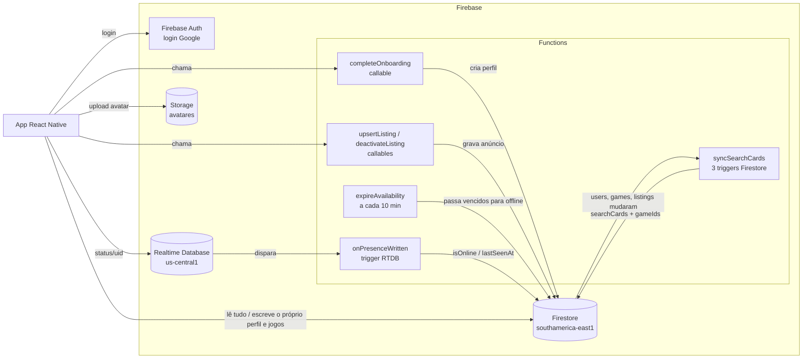

# Documentação do backend do MyNoobPro

Documentação técnica do repositório `player-2-backend`: o que existe, como
cada parte funciona passo a passo e por que foi feita desse jeito.

> **Estado documentado:** branch `main`, commit `6e743bc` (10/11/2026).
> Cobre as tarefas 1–18 do `TASKS.md` do app.
> Quando o código mudar, atualize o arquivo correspondente.

## O que é este repositório, em um parágrafo

O MyNoobPro **não tem servidor próprio**. O app React Native fala direto com
o Firebase (Auth, Firestore, Realtime Database, Storage e Cloud Functions).
Este repositório guarda e testa tudo o que roda **dentro** do Firebase:

- as **regras de segurança**, que decidem quem lê e escreve o quê;
- os **índices** das consultas compostas;
- as **Cloud Functions**, a lógica que o cliente não pode executar sozinho;
- os **scripts** que populam e corrigem o banco.

## Índice

| # | Arquivo | Conteúdo |
|---|---------|----------|
| 1 | [Arquitetura](01-arquitetura.md) | Visão geral, princípio "cliente lê, Function escreve", regiões, pastas, configuração |
| 2 | [Modelo de dados](02-modelo-de-dados.md) | Coleções, entidades de `types.ts`, quem escreve cada uma |
| 3 | [Regras de segurança](03-regras-de-seguranca.md) | `firestore.rules`, `storage.rules` e `database.rules.json`, regra por regra |
| 4 | [Índices](04-indices.md) | Cada índice composto e a consulta que o usa |
| 5 | [Function `completeOnboarding`](05-function-completeOnboarding.md) | Cadastro: idade, username, termos, criação do perfil |
| 6 | [Function `expireAvailability`](06-function-expireAvailability.md) | Expiração agendada da disponibilidade |
| 7 | [Function `onPresenceWritten`](07-function-onPresenceWritten.md) | Presença online: RTDB → Firestore |
| 8 | [Functions de `searchCards`](08-functions-searchCards.md) | Cartões de busca mantidos por 3 triggers |
| 9 | [Scripts e dados](09-scripts.md) | `bootstrap`, `seed-dev`, `rebuild-search-cards`, `data/` |
| 10 | [Testes](10-testes.md) | Como os testes rodam e o que cada um garante |
| 11 | [Operação e deploy](11-operacao-e-deploy.md) | Rodar local, publicar, branches, custos, incidentes |
| 12 | [Pontos de atenção](12-pontos-de-atencao.md) | Achados da análise do código e o que vem depois |
| 13 | [Do código ao Firebase](13-do-codigo-ao-firebase.md) | Como uma função escrita aqui passa a rodar no Firebase: gatilhos, `index.ts`, emulador e deploy |
| 14 | [Functions de anúncios](14-functions-listings.md) | `upsertListing` e `deactivateListing`: limites, preço só para companion |

## Mapa rápido

## Functions publicadas hoje

| Function | Tipo | Região | Disparo | Doc |
|----------|------|--------|---------|-----|
| `completeOnboarding` | callable (HTTPS) | southamerica-east1 | app chama no fim do passo "perfil" do onboarding | [5](05-function-completeOnboarding.md) |
| `expireAvailability` | agendada (Cloud Scheduler) | southamerica-east1 | a cada 10 min | [6](06-function-expireAvailability.md) |
| `onPresenceWritten` | trigger RTDB | **us-central1** | escrita em `/status/{uid}` | [7](07-function-onPresenceWritten.md) |
| `onUserWrittenSyncCards` | trigger Firestore | southamerica-east1 | escrita em `users/{uid}` | [8](08-functions-searchCards.md) |
| `onPlayerGameWrittenSyncCards` | trigger Firestore | southamerica-east1 | escrita em `users/{uid}/games/{gameId}` | [8](08-functions-searchCards.md) |
| `onListingWrittenSyncCards` | trigger Firestore | southamerica-east1 | escrita em `listings/{id}` | [8](08-functions-searchCards.md) |

> `upsertListing` e `deactivateListing` (tarefa 21, doc [14](14-functions-listings.md))
> ainda não foram publicadas.
>
> As três de `searchCards` foram publicadas em 10/11/2026, e os cartões de
> quem já tinha perfil foram recalculados (ver [Operação e deploy](11-operacao-e-deploy.md)).

## Documentos relacionados (repo do app)

- `MVP.md`: plano do produto, as decisões e o porquê delas.
- `MODELO_DE_DADOS.md`: fonte de verdade das entidades. O `types.ts` segue esse arquivo.
- `TASKS.md`: checklist da v0, com o que já está publicado.
- `PRECOS.md`: custos estimados do Firebase.
